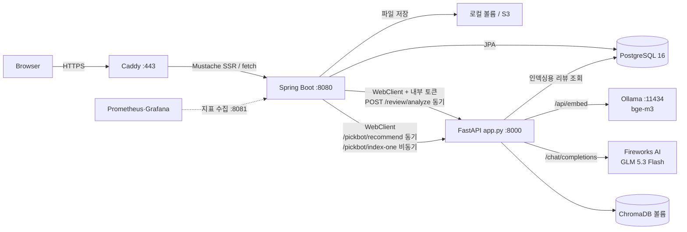

# MyPickCafe

리뷰 데이터를 기반으로 카페를 탐색하고 추천받는 웹 서비스입니다.

**🔗 배포 주소: https://mypickcafe.xyz**

## 개요

MyPickCafe는 실 방문자 리뷰를 바탕으로 취향과 목적에 맞는 카페를 찾는 서비스입니다. 원하는 조건으로 카페를 검색하거나, 자연어 질문을 통해 AI에게 카페를 추천받을 수 있습니다.

## 핵심 기술

- Java 17 / Spring Boot 3.5.5 (`web`, `data-jpa`, `validation`, `mustache`)
- Spring Security + JWT(세션 미사용), BCrypt
- JPA + PostgreSQL 16 (`docker-compose.yml`)
- FastAPI + ChromaDB
- 임베딩: `bge-m3` (Ollama 셀프 호스팅)
- LLM: GLM 5.3 Flash (Fireworks AI, OpenAI 호환 API, 로컬·배포 공통), 더미 데이터 생성만 `qwen2.5:14b` (Ollama)
- Docker / Docker Compose, Caddy(HTTPS), AWS EC2 (기존 배포 기록: t3.large, Ubuntu 24.04)
- 파일 저장: 로컬 디스크 / AWS S3 선택 (AWS SDK v2)
- GitHub Actions CI/CD, GHCR, AWS SSM(OIDC)
- Spring Boot Actuator + Micrometer, Prometheus·Grafana, k6 (모니터링·부하 테스트)

## 아키텍처



## 주요 기능 및 설계

- **자연어 요청을 처리하는 RAG 기반 AI 카페 추천 로직** — 1차 LLM 호출로 질문을 지역과 독립 조건 목록으로 나눕니다(ex: "용산에서 와이파이 빠르고 주차 편한 카페" → 지역 `용산`, 조건 `와이파이가 빠름`·`주차가 편함`). 지명 표현을 지명 맵(역·상권·별칭 약 500개)으로 카페 주소에 맞춰 필터링하고, 조건마다 bge-m3로 임베딩해 유사 리뷰를 검색합니다. 검색된 리뷰를 다른 조건들과의 추가 비교를 통해 카페별 조건 충족 범위로 순위를 매기고, 상위 카페와 조건별 근거 리뷰만 2차 LLM에 전달해 실제 충족 여부를 판정받아 반환합니다. 검색 대상은 Spring이 호출 시점에 넘긴 승인 카페 ID로 벡터 검색 전에 제한합니다.(카페 탐색의 '픽봇' 기능)

- **세션 미사용 JWT 인증** — 세션 없이 요청마다 JWT로 인증하고, 토큰의 tokenVersion을 DB의 회원 값과 비교합니다. 로그아웃이나 비밀번호 변경 시 DB의 tokenVersion 값을 증가시켜 기존 토큰을 무효화합니다.
  
- **로그인·비밀번호 보안** — 로그인 실패를 계정+IP·계정·IP 단위로 세어 한도를 넘으면 429와 `Retry-After`로 차단하고, 없는 이메일과 틀린 비밀번호에 같은 응답을 주어 가입 여부를 드러내지 않습니다. 비밀번호는 하나의 정책 클래스로 회원가입·변경·관리자 생성 경로를 모두 검사합니다(8~20자, BCrypt 72바이트 한도, 공백·흔한 비밀번호·이메일 아이디 포함 거절).
  
- **데이터 노출 최소화** — 승인 전·반려 카페는 점주와 관리자만 조회할 수 있고, 회원·카페·메뉴·알림·영업정보 API는 엔티티 대신 화면에 필요한 필드만 담은 record DTO로 응답합니다. 사업자 증빙은 URL로 서빙하지 않는 비공개 저장소에 두고 관리자 엔드포인트로만 내려줍니다.
  
- **니즈 태그 기반 자카르드 추천** — 사용자의 니즈와 카페 태그의 교집합 크기를 합집합 크기로 나눠 순위를 정하는 자카르드 유사도 알고리즘을 사용하여 추천합니다.(카페 탐색의 '맞춤 추천' 기능)
  
- **AI 기능별 실패 처리 정책** — 리뷰 태그 분석은 `WebClient`에 연결 2초·응답 10초 타임아웃을 적용하고, 호출 실패 시 빈 결과를 반환하며, 태그 분석·반영이 실패해도 작성한 리뷰는 저장된 상태로 유지합니다. 픽봇 추천은 장애와 ‘조건에 맞는 카페 없음’을 구분할 수 있도록 실패 원인을 분류해 로그로 남기고 503을 반환합니다.
  
- **AI 응답 대기 중 DB 커넥션 점유 개선** — 느린 AI 응답을 재현하는 가짜 AI 서버와 k6 시나리오로 측정해, AI 응답을 기다리는 요청이 DB 커넥션을 계속 점유하면서 동시 요청이 커넥션 풀(20개)을 넘으면 AI와 무관한 화면까지 느려지는 것을 확인했습니다. 리뷰 작성은 저장 커밋 → 트랜잭션 밖 AI 분석 → 태그 반영 트랜잭션으로 나누고, AI를 기다리는 경로는 Open Session In View 적용에서 제외해 동시 AI 요청 30건 구간의 열람 응답 p95를 5.71초에서 9.9ms로 개선했습니다.
  
- **LLM 추론과 임베딩의 분리 배치** — 개발 단계에서는 로컬 Ollama로 LLM과 임베딩을 모두 처리했으나, GPU가 없는 EC2 배포 환경의 메모리와 운영 자원 제약을 고려해 LLM 모델은 14B 모델을 직접 서빙하는 대신 외부 API를 선택했습니다. 무거운 LLM 추론은 외부 API로 분리하고, 가벼운 임베딩 모델은 서버 내 Ollama에 유지해 기존 벡터 인덱스와의 일관성을 확보했습니다.

- **HTTPS·내부망 분리 배포와 CI/CD** — Caddy로 HTTPS 인증서를 자동 발급·갱신하고 외부에는 80·443만 엽니다. Docker 네트워크를 프록시·백엔드·모니터링으로 나눠 DB·AI 서버는 외부와 프록시에서 닿지 않게 하고, Spring → AI 서버 호출에는 내부 토큰을 붙입니다. GitHub Actions에서 테스트와 이미지 빌드를 거친 main 이미지를 GHCR에 게시하고, 승인 후 SSM으로 EC2에 배포합니다.

- **파일 저장소 추상화** — `file.storage=local|s3` 설정으로 로컬 디스크와 S3를 전환합니다. S3에서는 DB에 객체 키만 저장하고 JPA `AttributeConverter`로 공개 URL을 만들어, 공개 주소가 바뀌어도 기존 데이터를 고치지 않아도 됩니다.

- **조회 인덱스 설계** — PostgreSQL이 FK 컬럼에 인덱스를 자동으로 만들지 않는 점을 고려해 자주 실행되는 조회에 복합 인덱스를 추가했고, `EXPLAIN ANALYZE`로 카페 상세 페이지의 리뷰 쿼리 시간이 약 18배(6.27ms → 0.36ms) 줄어든 것을 확인했습니다.

## 담당 기능

이 프로젝트는 팀 프로젝트 GoCafe를 기반으로 개인적으로 이어서 개발한 후속 프로젝트입니다. Spring Boot 도메인 뼈대와 회원·카페·리뷰 등 기본 기능, Spring Security + JWT 로그인과 `tokenVersion` 기반 토큰 무효화, Mustache 화면 기본 구성, 리뷰 데이터 등을 팀 원본에서 가져왔습니다. 이후 태그 체계 재정리와 니즈 기반 자카르드 추천, CAFEOWNER 역할 도입, 회원 API 인가 제한·응답 DTO 전환·소유권 검증 등의 보안 보완과 테스트, 리뷰 태그 분석과 픽봇 RAG 추천을 통합한 FastAPI AI 서버, 더미 데이터 생성 스크립트, Docker Compose 기반 EC2 배포를 재작업했습니다. 그 위에 로그인 실패 제한·비밀번호 정책·승인 전 카페 노출 차단·사업자 증빙 비공개 저장 등의 보안 강화, Caddy HTTPS와 내부망 분리, GitHub Actions CI/CD, S3 파일 저장소, 조회 인덱스를 추가했고, Prometheus·Grafana 모니터링과 k6 부하 테스트 환경을 구성해 AI 응답 대기 중 DB 커넥션 점유를 측정·개선했습니다.

## 실행 방법

```bash
cp .env.example .env
# .env에 POSTGRES_PASSWORD, LLM_API_KEY, JWT_SECRET 입력
# 배포 서버에서는 DOMAIN, AI_INTERNAL_TOKEN도 입력

docker compose up -d --build
```

실행 후 https://localhost 로 접속합니다. `DOMAIN`을 비우면 Caddy가 자체 서명 인증서로 실행됩니다.

---

상세 설계·API 명세·인증 흐름 등은 [ARCHITECTURE.md](ARCHITECTURE.md) 참고.

## CI/CD

GitHub Actions CI 구성, 테스트 범위, 로컬 실행 방법과 EC2 배포(CD) 흐름·최초 설정은 [CI/CD 안내](docs/CI_CD.md)를 참고하세요.

## 모니터링·부하 테스트

Prometheus·Grafana로 Spring Boot 지표(응답 시간·DB 커넥션 풀·Tomcat 스레드·AI 호출)를 확인하고, k6로 스모크·부하·스트레스·느린 AI 시나리오를 실행합니다. 실행 방법, 부하 수치의 근거, 수정 전후 측정 기록은 [모니터링·부하 테스트 안내](docs/MONITORING.md)를 참고하세요.
