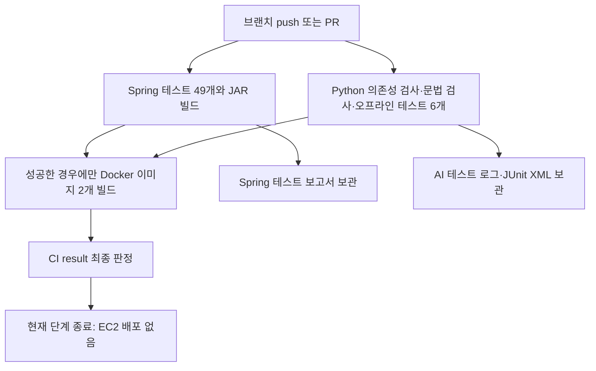
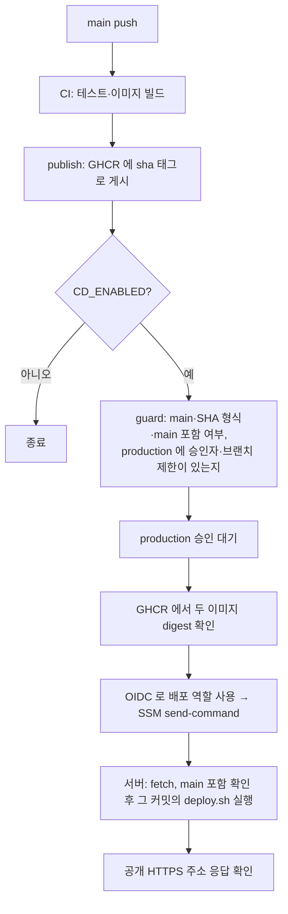

# MyPickCafe CI/CD

## 작업 범위

`ci/github-actions` 브랜치에서 **CI**를, `cd/ec2-deployment` 브랜치에서 **CD**(GHCR 게시 + SSM 으로 EC2 배포)를 구현했다.
CD 는 저장소 변수 `CD_ENABLED=true` 를 넣기 전까지 꺼져 있다. AWS·GitHub 설정은 아래 "CD 최초 설정"에 따라 사용자가 직접 한다.
작업 중 EC2 접속, 실제 배포, 원격 GitHub·AWS 설정 변경, DB 초기화는 하지 않았다.

CI는 코드가 정상인지 자동 검사하는 과정이고, CD는 검사를 통과한 버전을 실제 서버에 반영하는 과정이다.
CD 를 켜도 production 승인 전에는 운영 서버가 바뀌지 않는다.

## 현재 프로젝트 분석

| 파일/구성 | 현재 역할과 CI/CD에서의 의미 |
| --- | --- |
| `docker-compose.yml` | 저장소 루트에서 전체 서비스를 연결한다. 프로젝트 이름은 `mypickcafe`로 고정되어 있다. PostgreSQL, Ollama, AI, Spring, Caddy가 기본 구성이다. |
| `MyPickCafe_Springboot/Dockerfile` | Java 17 JDK에서 Gradle Wrapper 8.14.3으로 JAR를 만들고 JRE 이미지에서 실행한다. 이미지 빌드 자체는 테스트를 생략하므로 CI가 먼저 테스트해야 한다. UID 10001로 실행한다. |
| `MyPickCafe_AI/Dockerfile` | Python 3.11에 `requirements.txt`를 설치하고 통합 `app.py`를 Uvicorn 단일 프로세스로 실행한다. UID 10001이며 인덱스와 로그를 볼륨에 둔다. |
| 각 `.dockerignore` | `.env`, 로컬 비밀 설정, 가상환경, 데이터/로그 등을 빌드 컨텍스트에서 제외한다. Spring은 필요한 소스만 COPY하고 AI는 컨텍스트를 COPY한다. |
| `build.gradle` | Spring Boot 3.5.5, Java 17, JUnit, Mockito, H2 테스트 의존성을 정의한다. 기존 구성을 그대로 사용한다. |
| `application.properties` | 기본 프로파일은 dev. 공통 설정과 환경변수 참조를 정의하고 로컬 `secret.properties`를 선택적으로 읽는다. |
| `application-dev.properties` | 개발 PostgreSQL, `ddl-auto=update`, 개발용 쿠키/로깅 설정이다. CI에서는 사용하지 않는다. |
| `application-prod.properties` | 환경변수 기반 DB 연결, `ddl-auto=validate`, HTTPS 쿠키, CORS 허용 목록, Swagger 비활성화. DB 스키마가 맞지 않으면 기동 실패한다. |
| `src/test/resources/application-test.properties` | 외부 PostgreSQL 대신 메모리 H2를 사용한다. `create-drop`은 이 임시 H2에만 적용한다. 테스트 JWT와 AI 실패 경로용 로컬 주소를 사용한다. |
| `MyPickCafe_AI/app.py` | PickBot과 리뷰 분석을 한 FastAPI 앱에 제공한다. 기동할 때 Chroma 인덱스가 비어 있으면 PostgreSQL에서 읽어 인덱싱한다. CI에서 실제 lifespan을 시작하지 않는다. |
| AI의 각 `config.py` | `pydantic-settings`로 환경변수와 `MyPickCafe_AI/.env`를 읽는다. Chroma 경로는 AI 소스 루트 기준으로 해석한다. |
| `Caddyfile` | 외부 HTTPS 요청을 Spring으로 전달한다. 인증서는 Caddy 볼륨에 보존된다. |
| `.env.example`, `secret.properties.example` | 필요한 설정 이름을 설명하는 예시다. 실제 비밀값을 채워 커밋하면 안 된다. |

Spring의 `DataInitializer`는 `@Component`가 주석 처리되어 있어 현재 자동 실행되지 않는다.
ChromaDB는 별도 서버가 아니라 AI 프로세스의 `PersistentClient`가 `chroma-index` 볼륨을 직접 사용한다.
Compose의 `chromadb` 서비스는 선택적 `chroma-server` 프로파일이며 현재 앱이 사용하는 저장소가 아니다.

### 운영에서 유지하거나 보완해야 하는 부분

- 기존 볼륨 이름과 마운트를 유지해야 한다. 경로나 프로젝트 이름을 바꾸면 기존 데이터가 있어도 새 빈 저장소를 볼 수 있다.
- PostgreSQL은 현재 `5432:5432`, AI는 `8000:8000`으로 모든 인터페이스에 바인딩된다. 옵션 Chroma 서버도 `8002:8000`이다. 실제 인터넷 접근 여부는 EC2 보안 그룹 등에 따라 다르다. 이번 CI는 포트를 추가하지 않는다. CD 단계에서 기존 외부 사용 여부를 확인하고 내부 전용 또는 loopback으로 제한한다.
- Spring 8080은 이미 `127.0.0.1`에만 바인딩되어 있고, Ollama 포트는 기본 공개되지 않는다. 일반 사용자 요청은 Caddy의 80/443을 사용한다.
- Spring Docker healthcheck는 TCP 포트 열림만 확인한다. AI `/health`는 `status=ok`와 인덱스 건수를 제공하지만 DB·LLM 전체 정상 여부를 보장하지 않는다. CD 성공 판정에는 별도의 HTTP 확인 및 예상 인덱스 확인이 필요하다.
- Python 의존성은 `>=` 범위이고 일부 기반 이미지는 가변 태그다. **CD 전에는 운영 ChromaDB/라이브러리 버전을 확인하고 검증된 버전으로 고정해야 한다.** 최신 Chroma가 기존 파일 형식을 바꾸면 이전 이미지로 되돌리는 것만으로 복구하지 못할 수 있다. 이번에는 운영 의존성을 임의로 변경하지 않았다.
- UID 10001이 기존 볼륨에 쓸 수 있는지도 배포 사전 점검 대상이다. 자동 `chown`으로 운영 볼륨을 일괄 수정하지 않는다.

## 구현한 CI 파일

| 파일 | 역할 |
| --- | --- |
| `.github/workflows/ci.yml` | push, PR 생성/갱신, 수동 실행에 반응하여 Java/Python 검사와 Docker 빌드를 실행한다. 반드시 저장소 루트의 `.github/workflows`에 있어야 한다. |
| `scripts/ci/run_ai_tests.py` | 서비스 없이 실행할 수 있다고 확인한 Python 테스트 6개만 실행한다. 임시 소스 복사본, 파일별 프로세스, 120초 제한, 실패 로그와 JUnit XML을 제공한다. |
| `docs/CI_CD.md` | 현재 분석, 실행 방법, 실패 확인 방법, 다음 CD 단계의 설계를 설명한다. |
| 루트 `.gitignore` | 기존 Markdown 제외 규칙에서 이 안내 문서만 추적할 수 있도록 예외를 추가했다. |
| `README.md` | 이 안내 문서로 이동하는 링크를 추가했다. |



Java와 Python 작업은 각각 GitHub의 임시 Ubuntu 24.04 실행기에서 수행된다.
CI에 PostgreSQL/Ollama/Chroma 서비스를 띄우지 않으며 운영 볼륨을 연결하지 않는다.
의존성 다운로드와 이미지 빌드에는 인터넷이 필요하지만 테스트에 운영 API 키는 필요하지 않다.

AI 테스트를 실행하기 전에 앱 소스와 필요한 JSON, 허용한 테스트만 임시 폴더로 복사한다.
원본 `.env`, Chroma 파일, 로그, 가상환경은 복사하지 않는다. 개발자 셸의 AI/DB 설정도 테스트용 값으로 교체한다.
모듈 import 시 생성되는 RAG 로그도 임시 폴더에만 남는다.
Python 소켓 연결 시도를 감지하면 실패시키며, Windows asyncio 내부 socketpair만 예외로 둔다.
이는 실수 방지 장치이며 OS 방화벽 수준의 격리 장치는 아니다. 네이티브 DB 드라이버는 별도이므로 DB 주소도 로컬 미사용 포트와 가짜 인증 정보로 설정한다.

Docker 빌드는 두 Dockerfile을 그대로 사용하고 이미지를 게시하거나 컨테이너를 실행하지 않는다.
Compose 검사는 빈 환경 파일과 가짜 값으로 `config --quiet`만 실행한다.
테스트가 실패하면 Docker 작업을 건너뛰며, 최종 `CI result`도 실패한다. 실패를 성공으로 처리하는 `continue-on-error`는 없다.
같은 브랜치에 새 변경이 올라오면 이전 동일 이벤트의 CI를 취소한다. PR 검사와 push 검사는 별개로 실행될 수 있다.
외부 Actions는 확인한 릴리스의 전체 commit SHA로 고정하고 저장소 권한은 `contents: read`만 부여했다.

## 테스트 범위

| 분류 | 대상 | 실행 조건 |
| --- | --- | --- |
| CI 포함 | Spring 테스트 클래스 14개, 테스트 49개 | Java 17, H2, Mockito. 보안/소유권/로그인/렌더링/서비스/AI 장애 처리를 검사한다. 일부는 임시 로컬 HTTP 서버 또는 닫힌 로컬 포트를 사용한다. |
| CI 포함 | `test_condition_search.py` | 가짜 벡터·임베딩·LLM으로 조건별 검색/순위를 검사한다. |
| CI 포함 | `test_parse_timeout.py` | LLM을 모킹하여 타임아웃과 대체 동작을 검사한다. |
| CI 포함 | `test_pick_trace.py` | 가짜 외부 의존성과 임시 로그로 추적 로그를 검사한다. |
| CI 포함 | `test_query_length.py` | Pydantic 및 테스트용 FastAPI 앱으로 입력 길이를 검사한다. 실제 통합 앱 기동 검사는 아니다. |
| CI 포함 | `test_region_filter.py`, `test_region_map.py` | 지역 필터와 별칭, LLM 모킹, 임시 후보 파일을 검사한다. |
| 자동 CI 제외 | `test_query_parser.py` | 실제 LLM/DB를 사용하는 평가 스크립트. 별도 테스트용 서비스/데이터가 필요하다. |
| 자동 CI 제외 | `test_pick_llm.py`, `test_pick_reviews_per_cafe.py` | 실제 LLM 호출 및 RAG 입력 준비에 서비스/데이터가 필요하다. 비용과 실행 시간도 고려해야 한다. |
| 자동 CI 제외 | `Review_Tag_AI/tests/test_api.py` | 실제 LLM을 호출하는 리뷰 분석 검사다. |
| 자동 CI 제외 | `Create_Dummy/tests/test_batch.py`, `test_deep.py` | 로컬 Ollama/qwen 모델을 사용하는 더미 생성 관련 검사다. |
| 후속 통합 검사 | 운영 PostgreSQL과 동등한 스키마, 저장된 Chroma 인덱스, Ollama, LLM, Caddy HTTPS | 별도 검증 환경에서 수행한다. 운영 데이터를 지우거나 운영 재인덱싱 API를 호출하는 방식으로 검사하지 않는다. |

기존 Python 테스트는 `main()`과 종료 코드로 결과를 알리는 스크립트다.
저장소 전체에 `pytest`를 실행하면 의도하지 않은 외부 평가 스크립트를 import하거나 실제 검사를 놓칠 수 있어 사용하지 않았다.
JUnit 보고서의 Python 테스트 건수는 내부 개별 assertion 수가 아니라 **스크립트 6개 + 문법 검사 1개**다.
H2 통과가 PostgreSQL 전용 SQL/운영 스키마 호환성을 보장하지는 않는다.

## 로컬 재현과 실패 확인

저장소 루트에서 Linux/macOS:

```bash
cd MyPickCafe_Springboot
SPRING_PROFILES_ACTIVE=test bash ./gradlew --no-daemon --console=plain test bootJar
cd ..
python3.11 -m venv MyPickCafe_Springboot/build/ci-venv
MyPickCafe_Springboot/build/ci-venv/bin/python -m pip install -r MyPickCafe_AI/requirements.txt
MyPickCafe_Springboot/build/ci-venv/bin/python -m pip check
MyPickCafe_Springboot/build/ci-venv/bin/python scripts/ci/run_ai_tests.py
```

Windows PowerShell에서는 Java 17을 `JAVA_HOME`으로 선택한 뒤:

```powershell
$env:SPRING_PROFILES_ACTIVE = 'test'
Push-Location MyPickCafe_Springboot
.\gradlew.bat --no-daemon --console=plain test bootJar
Pop-Location
py -3.11 -m venv MyPickCafe_Springboot/build/ci-venv
& .\MyPickCafe_Springboot\build\ci-venv\Scripts\python.exe -m pip install -r MyPickCafe_AI/requirements.txt
& .\MyPickCafe_Springboot\build\ci-venv\Scripts\python.exe -m pip check
& .\MyPickCafe_Springboot\build\ci-venv\Scripts\python.exe scripts/ci/run_ai_tests.py
```

이 가상환경과 보고서는 Git에서 제외되는 `build/` 아래에 둔다. 이후 Gradle `clean`은 이 가상환경도 지우므로 필요하면 다시 만든다.

GitHub에서는 **Actions → CI → 해당 실행 → 실패한 job/step**을 열어 첫 오류를 확인한다.
실행 화면의 Artifacts에서 `spring-test-reports`, `ai-test-reports`를 내려받을 수 있다(7일 보관).
Spring HTML은 `build/reports/tests/test/index.html`, AI 상세 로그와 XML은 `build/reports/ai/`에 생성된다.
의존성 설치나 컴파일 이전에 실패하면 테스트 보고서가 없을 수 있으므로 Actions 단계 로그를 확인한다.
취소된 실행/실행기 강제 종료의 보고서 업로드까지 보장하지는 않는다.
Docker 실패 원인은 해당 Build step 로그를 확인한다.

GitHub에서 CI를 사용하려면 이 브랜치의 변경 파일을 커밋/push하고 Actions를 허용해야 한다.
이번 작업에서는 원격 push를 하지 않았다. 첫 원격 실행 후 `CI result`를 main의 필수 상태 검사로 지정하는 것을 권장한다.
필수 검사 지정은 GitHub Rulesets/Branch protection의 별도 설정이며 이 YAML만으로 병합이 강제 차단되지는 않는다.
일부 fork PR은 저장소 정책에 따라 Actions 실행 승인 자체가 필요할 수 있다.

## CD — EC2 배포

`cd/ec2-deployment` 브랜치에서 구현했다. 무중단 배포는 범위에 없다. web·ai 컨테이너를 교체하는 동안 잠시 접속이 끊긴다.
저장소 변수 `CD_ENABLED=true` 를 넣기 전까지는 배포 job 이 건너뛰어진다. 아래 "CD 최초 설정"을 끝낸 뒤에 켠다.

### 정한 방식

| 항목 | 선택 | 이유 |
| --- | --- | --- |
| 서버 접속 | AWS SSM + GitHub OIDC | 22번 포트를 GitHub 실행기 대역에 열지 않는다. 장기 AWS 키·SSH 키를 GitHub 에 저장하지 않는다. |
| 실행 시점 | main push → CI 통과 → 이미지 게시 → `production` 승인 후 배포 | 승인 없이는 서버가 바뀌지 않는다. 수동 실행(되돌리기)도 같은 승인을 거친다. |
| 이미지 | Actions 에서 빌드해 GHCR 에 게시, EC2 는 digest 로 pull | CI 에서 테스트한 커밋 그대로 배포한다. t3.large 에서 Gradle 빌드를 하지 않는다. 되돌리기는 이전 커밋의 이미지로 다시 배포하면 된다. |

### 파일

| 파일 | 역할 |
| --- | --- |
| `.github/workflows/ci.yml` | `cd-script` job(배포 스크립트 ShellCheck·가짜 명령 테스트) 추가. main 에서만 `publish` job 이 `ghcr.io/hsh1121/mypickcafe-{web,ai}:sha-<커밋>` 을 게시하고, `CD_ENABLED=true` 면 `deploy` job 이 Deploy 워크플로를 부른다. main 실행은 새 push 가 와도 취소하지 않는다. |
| `.github/workflows/deploy.yml` | 배포 워크플로. CI 가 부르거나(workflow_call) Actions 화면에서 SHA 를 넣어 직접 실행한다(workflow_dispatch). |
| `scripts/cd/deploy.sh` | 서버에서 실행하는 배포 스크립트. 배포할 커밋의 파일을 `git show` 로 꺼내 실행하므로 서버에 따로 설치하지 않는다. |
| `scripts/cd/test_deploy.sh` | 가짜 docker·git 으로 `deploy.sh` 의 순서와 실패 처리를 확인한다(13개 경우, 59개 검사). 실제 컨테이너를 건드리지 않는다. |

### 배포 흐름



서버의 `deploy.sh` 순서. 앞 단계가 끝나기 전에는 실행 중인 서비스를 건드리지 않는다.

1. **사전 점검**: 서버 측 잠금(`flock`), 커밋이 `origin/main` 에 있는지, 서버 저장소에 수정된 추적 파일이 없는지, 필수 볼륨(`mypickcafe_pgdata`, `mypickcafe_chroma-index`, `mypickcafe_web-uploads`)이 있는지, 앱이 쓰는 볼륨의 소유자가 uid 10001 인지, postgres 가 healthy 인지 확인한다. 현재 AI 인덱스 건수도 기록한다.
2. **pull**: 두 이미지를 `이름@sha256:digest` 로 받는다.
3. **설정 검사**: 서버 저장소를 그 커밋으로 `checkout --detach` 하고, 이미지 override(`/var/lib/mypickcafe-deploy/images.override.yml.candidate`)를 붙여 `compose config --quiet` 를 실행한다. 실패하면 checkout 을 원래대로 돌려 놓는다.
4. **교체**: `compose up -d --no-deps --no-build mypickcafe-ai mypickcafe-web`. postgres·ollama·caddy 는 그대로 둔다.
5. **확인**: 두 컨테이너가 healthy 인지(ai 최대 15분, web 5분, 재시작 반복이면 바로 실패), 실행 중인 이미지가 배포한 digest 인지, `http://127.0.0.1:WEB_PORT/` 가 2xx/3xx 인지, AI 인덱스 건수가 배포 전보다 줄지 않았는지(배포 전에 확인할 수 없었으면 0건이 아닌지) 확인한다.
6. **기록**: 성공하면 override 를 `images.override.yml` 로 확정하고 `/var/lib/mypickcafe-deploy/current`·`previous`·`history` 에 SHA 와 digest 를 남긴다.

스크립트에 넣지 않은 것: `compose down`, 볼륨 삭제·prune, DB 초기화·스키마 변경, Chroma 초기화·재인덱싱, 볼륨 `chown`, 실패 시 자동 되돌리기.

공개 저장소라 Actions 로그는 누구나 볼 수 있다. `deploy.sh` 는 비밀값과 앱 로그를 출력하지 않는다.
`.env` 내용이 담기는 `compose config` 는 `--quiet` 로만 쓴다. 실패했을 때의 컨테이너 상태와 최근 로그 200줄은 서버의 `/var/lib/mypickcafe-deploy/last-failure.log` 에만 남긴다(root 전용 폴더).

### 실패와 되돌리기

- 1~3단계에서 실패하면 서비스는 그대로다. 실패 이유가 Actions 로그에 남는다.
- 4~5단계에서 실패하면 web·ai 가 중단됐거나 새 버전이 일부만 떠 있을 수 있다. **자동으로 되돌리지 않는다.**
- 되돌리기: **Actions → Deploy → Run workflow** 를 main 에서 실행하고 `sha` 에 이전 성공 SHA 를 넣는다. 로그 끝에 이전 성공 SHA 가 찍히고, 서버의 `/var/lib/mypickcafe-deploy/current`·`history` 에도 있다. 이것도 production 승인을 거친다.
- 스키마 변경(prod 는 `ddl-auto=validate`)이나 Chroma 파일 형식 변경이 들어간 배포는 이미지만 되돌려서는 복구되지 않을 수 있다. 그런 변경은 배포 전에 SQL·백업을 따로 준비한다.
- CD 로 처음 배포하기 전에는 이전 성공 기록이 없다. 그때 실패하면 스크립트가 서버에서 직접 되돌리는 명령(원래 브랜치 checkout 뒤 기존 `mypickcafe-*:dev` 이미지로 `up --no-deps --no-build`)을 출력한다.

### CD 최초 설정 (사용자가 직접)

Claude 는 AWS·GitHub 원격 설정과 EC2 접속을 하지 않았다. 아래 순서대로 설정한 뒤 마지막에 `CD_ENABLED` 를 켠다.

**1. EC2 에서 SSM 사용**

- Ubuntu 24.04 AMI 에는 `amazon-ssm-agent` 가 snap 으로 들어 있다(`sudo snap services amazon-ssm-agent`).
- 인스턴스 IAM 역할에 `AmazonSSMManagedInstanceCore` 정책을 붙인다. 인스턴스 역할은 하나만 붙으므로, S3 용 역할이 이미 있으면 그 역할에 정책을 추가한다.
- AWS 콘솔 **Systems Manager → Fleet Manager** 에서 인스턴스가 Online 인지 확인한다(아웃바운드 443 필요, 이미 열려 있음).

**2. GitHub OIDC 공급자** (계정에 한 번)

IAM → Identity providers → Add provider → OpenID Connect

- Provider URL: `https://token.actions.githubusercontent.com`
- Audience: `sts.amazonaws.com`

**3. 배포용 IAM 역할** (예: `mypickcafe-github-deploy`)

신뢰 정책. `production` Environment 의 job 만 이 역할을 쓸 수 있다.

```json
{
  "Version": "2012-10-17",
  "Statement": [{
    "Effect": "Allow",
    "Principal": { "Federated": "arn:aws:iam::<계정ID>:oidc-provider/token.actions.githubusercontent.com" },
    "Action": "sts:AssumeRoleWithWebIdentity",
    "Condition": {
      "StringEquals": {
        "token.actions.githubusercontent.com:aud": "sts.amazonaws.com",
        "token.actions.githubusercontent.com:sub": "repo:HsH1121/MyPickCafe:environment:production"
      }
    }
  }]
}
```

권한 정책. 이 인스턴스 하나에 `AWS-RunShellScript` 실행과 결과 조회만 허용한다.

```json
{
  "Version": "2012-10-17",
  "Statement": [
    {
      "Effect": "Allow",
      "Action": "ssm:SendCommand",
      "Resource": [
        "arn:aws:ec2:ap-northeast-2:<계정ID>:instance/<인스턴스ID>",
        "arn:aws:ssm:ap-northeast-2::document/AWS-RunShellScript"
      ]
    },
    {
      "Effect": "Allow",
      "Action": ["ssm:GetCommandInvocation", "ssm:ListCommandInvocations"],
      "Resource": "*"
    }
  ]
}
```

`AWS-RunShellScript` 는 임의 명령을 root 로 실행할 수 있는 문서다. 이 역할은 승인된 `production` job 만 쓸 수 있게 신뢰 정책으로 묶었다. 더 좁히려면 배포 명령만 받는 전용 SSM 문서를 만들어 바꾼다.

**4. GitHub `production` Environment**

Settings → Environments → New environment → `production`

- **Required reviewers**: 본인. 혼자 쓰는 저장소이므로 "Prevent self-review" 는 끈다.
- **Deployment branches and tags**: Selected branches and tags → `main`
- **Environment variables**

| 이름 | 예 | 비고 |
| --- | --- | --- |
| `AWS_REGION` | `ap-northeast-2` | |
| `AWS_DEPLOY_ROLE_ARN` | `arn:aws:iam::<계정ID>:role/mypickcafe-github-deploy` | |
| `EC2_INSTANCE_ID` | `i-0123456789abcdef0` | |
| `EC2_APP_DIR` | `/home/ubuntu/MyPickCafe` | 서버의 저장소 경로(`docker-compose.yml`·`.env` 가 있는 곳) |
| `PRODUCTION_URL` | `https://<도메인>` | 비워 두면 공개 HTTPS 확인을 건너뛴다 |

Deploy 워크플로의 `guard` job 은 Required reviewers 와 배포 브랜치 제한이 없으면 배포를 멈춘다. Secrets 는 필요 없다.

**5. GHCR 이미지 읽기**

첫 main push 에서 `publish` 가 `mypickcafe-web`·`mypickcafe-ai` 패키지를 만든다. 둘 중 하나를 고른다.

- 패키지를 Public 으로 바꾼다(GitHub 프로필 → Packages → 패키지 → Package settings → Change visibility). 소스가 이미 공개이고, 이미지에는 `.env`·`secret.properties` 가 들어가지 않는다(각 `.dockerignore`).
- Private 로 두려면 `read:packages` 권한만 있는 토큰을 만들어 서버에서 **root 로** 한 번 로그인한다(SSM 이 root 로 실행하므로). `sudo docker login ghcr.io -u HsH1121`

**6. 서버 사전 조건**

- `EC2_APP_DIR` 은 이 저장소의 git clone 이고 원격 이름이 `origin` 이어야 한다. 추적 파일을 서버에서 고친 상태면 배포를 멈춘다(`.env` 는 추적하지 않으므로 상관없다).
- 배포 후 서버 저장소는 배포한 커밋에 detached HEAD 로 있다. 서버에서 `git pull` 을 하지 않는다.
- docker compose v2 가 있어야 한다.
- 볼륨 이름과 소유자를 확인한다. 소유자가 10001 이 아니면 배포가 멈추며, 확인한 뒤 직접 `chown` 한다.

```bash
sudo docker volume ls --filter name=mypickcafe_
for v in chroma-index ai-logs web-uploads web-private; do
  mp=$(sudo docker volume inspect -f '{{.Mountpoint}}' mypickcafe_$v 2>/dev/null) && sudo stat -c "%u $v" "$mp"
done
```

- 서버에서 compose 를 직접 다룰 때는 배포된 이미지를 쓰도록 override 를 함께 넘긴다. 빼면 compose 가 예전 `mypickcafe-*:dev` 이미지나 서버 빌드로 돌아간다.

```bash
sudo docker compose -f docker-compose.yml -f /var/lib/mypickcafe-deploy/images.override.yml ps
```

**7. ChromaDB 버전 확인**

`MyPickCafe_AI/requirements.txt` 는 `>=` 범위라, Actions 에서 새로 빌드한 이미지에는 서버에서 쓰던 것보다 새 chromadb 가 들어갈 수 있다.
새 버전이 인덱스 파일 형식을 바꾸면 이전 이미지로 되돌려도 인덱스를 못 읽을 수 있다. 처음 켜기 전에 서버 버전을 확인하고, 다르면 그 버전으로 고정하는 커밋을 먼저 넣는다.

```bash
sudo docker exec mypickcafe-ai pip show chromadb | head -2
```

**8. 백업**

배포 스크립트는 데이터를 지우지 않지만, 처음 켜기 전에 PostgreSQL 백업(`pg_dump`)을 한 번 받아 둔다. Chroma 는 실행 중인 SQLite 파일을 그대로 복사하지 않는다. AI 컨테이너를 멈춘 상태에서 볼륨을 복사하거나, DB 에서 다시 인덱싱할 수 있으니 PostgreSQL 백업을 우선한다.

**9. 켜기**

Settings → Secrets and variables → Actions → **Variables** 탭(저장소 변수) → `CD_ENABLED` = `true`.
그다음 main push 부터 `publish` 뒤에 `Deploy` 가 승인을 기다린다. 이미 게시된 커밋은 Actions → Deploy → Run workflow 로 배포할 수 있다.

## 검증 결과와 남은 검증

- 로컬 Java 17/Gradle: 테스트 49개, 실패 0, 건너뜀 0, `bootJar` 성공.
- Python 3.11의 새 가상환경: 실제 AI `requirements.txt` 설치 및 `pip check` 성공.
- AI 오프라인 스크립트 6개와 소스 문법 검사 통과.
- Compose: 가짜 환경값과 빈 env 파일로 `config --quiet` 통과. 서비스 시작 없음.
- GitHub Actions: actionlint 1.7.12 정적 검사 통과.
- 실행기 실패 경로: 외부 연결 오류를 앱이 잡아도 CI 실패로 처리되는지, 테스트가 실패하면 최종 종료 코드와 JUnit에 실패가 남는지 임시 샘플로 확인했다.
- 로컬 Docker 엔진이 실행 중이 아니어서 이미지 빌드는 수행하지 못했다. GitHub Ubuntu 실행기의 실제 Docker 빌드 성공을 확인해야 한다.
- GitHub Actions 원격 실행, EC2 배포, 운영 연동 테스트는 수행하지 않았다.
- CD(`cd/ec2-deployment`): `scripts/cd/test_deploy.sh` 59개 검사 통과(Git Bash). 테스트가 실제로 잡는지 보려고 스크립트를 6가지로 일부러 망가뜨려(checkout 복구 제거, pull 실패 무시, 볼륨 검사 제거, 앱 로그 출력, 인덱스 검사 무력화, 교체 전 성공 기록) 돌렸을 때 6개 모두 실패로 잡혔다.
- CD: 두 워크플로 YAML 파싱, `bash -n`, SSM 으로 보내는 명령을 예시 값으로 만들어 `sh -n` 확인. 로컬에서 actionlint·ShellCheck 는 실행하지 못했다(ShellCheck 는 CI 의 `cd-script` job 에서 실행).
- CD: GHCR 게시, OIDC 역할 사용, SSM 실행, 실제 서버 배포는 원격 설정이 필요해 확인하지 못했다. 첫 배포는 승인 화면에서 지켜보며 실행한다.

## 참고한 공식 문서

- [GitHub Actions 보안과 SHA 고정](https://docs.github.com/en/actions/reference/security/secure-use)
- [GitHub 배포 Environment](https://docs.github.com/en/actions/how-tos/deploy/configure-and-manage-deployments/manage-environments)
- [Docker Compose 볼륨 이름과 external](https://docs.docker.com/reference/compose-file/volumes/)
- [Docker Compose override 병합](https://docs.docker.com/reference/compose-file/merge/)
- [GitHub Actions OIDC 로 AWS 역할 사용](https://docs.github.com/en/actions/how-tos/secure-your-work/security-harden-deployments/oidc-in-aws)
- [GHCR 에 이미지 게시](https://docs.github.com/en/packages/working-with-a-github-packages-registry/working-with-the-container-registry)
- [AWS SSM Run Command](https://docs.aws.amazon.com/systems-manager/latest/userguide/run-command.html)
