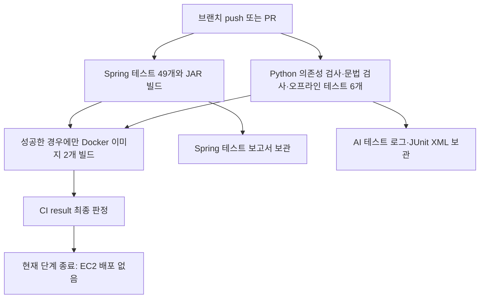

# MyPickCafe CI와 다음 단계의 CD

## 이번 작업의 범위

`ci/github-actions` 브랜치에서 **CI를 구현**했다. CD는 아래 설계에 따라 별도 브랜치/PR에서 진행한다.
EC2 접속, 배포, 원격 GitHub 설정 변경, 이미지 게시, DB 초기화는 하지 않았다.
기존 `docker-compose.yml`에 있던 `SERVER_FORWARD_HEADERS_STRATEGY: native` 변경도 그대로 유지했다.

CI는 코드가 정상인지 자동 검사하는 과정이고, CD는 검사를 통과한 버전을 실제 서버에 반영하는 과정이다.
이번에는 CI만 연결하므로 push/PR이 운영 서버를 재시작하지 않는다.

## 현재 프로젝트 분석

| 파일/구성 | 현재 역할과 CI/CD에서의 의미 |
| --- | --- |
| `docker-compose.yml` | 저장소 루트에서 전체 서비스를 연결한다. 프로젝트 이름은 `mypickcafe`로 고정되어 있다. PostgreSQL, Ollama, AI, Spring, Caddy가 기본 구성이다. |
| `MyPickCafe_Springboot/Dockerfile` | Java 17 JDK에서 Gradle Wrapper 8.14.3으로 JAR를 만들고 JRE 이미지에서 실행한다. 이미지 빌드 자체는 테스트를 생략하므로 CI가 먼저 테스트해야 한다. UID 10001로 실행한다. |
| `MyPickCafe_AI/Dockerfile` | Python 3.11에 `requirements.txt`를 설치하고 통합 `app.py`를 Uvicorn 단일 프로세스로 실행한다. UID 10001이며 인덱스와 로그를 볼륨에 둔다. |
| 각 `.dockerignore` | `.env`, 로컬 비밀 설정, 가상환경, 데이터/로그 등을 빌드 컨텍스트에서 제외한다. Spring은 필요한 소스만 COPY하고 AI는 컨텍스트를 COPY한다. |
| `build.gradle` | Spring Boot 3.5.5, Java 17, JUnit, Mockito, H2 테스트 의존성을 정의한다. 기존 구성을 그대로 사용한다. |
| `application.properties` | 기본 프로파일은 dev. 공통 설정과 환경변수 참조를 정의하고 로컬 `secret.properties`를 선택적으로 읽는다. |
| `application-dev.properties` | 개발 PostgreSQL, `ddl-auto=update`, 개발용 쿠키/로깅 설정이다. CI에서는 사용하지 않는다. |
| `application-prod.properties` | 환경변수 기반 DB 연결, `ddl-auto=validate`, HTTPS 쿠키, CORS 허용 목록, Swagger 비활성화. DB 스키마가 맞지 않으면 기동 실패한다. |
| `src/test/resources/application-test.properties` | 외부 PostgreSQL 대신 메모리 H2를 사용한다. `create-drop`은 이 임시 H2에만 적용한다. 테스트 JWT와 AI 실패 경로용 로컬 주소를 사용한다. |
| `MyPickCafe_AI/app.py` | PickBot과 리뷰 분석을 한 FastAPI 앱에 제공한다. 기동할 때 Chroma 인덱스가 비어 있으면 PostgreSQL에서 읽어 인덱싱한다. CI에서 실제 lifespan을 시작하지 않는다. |
| AI의 각 `config.py` | `pydantic-settings`로 환경변수와 `MyPickCafe_AI/.env`를 읽는다. Chroma 경로는 AI 소스 루트 기준으로 해석한다. |
| `Caddyfile` | 외부 HTTPS 요청을 Spring으로 전달한다. 인증서는 Caddy 볼륨에 보존된다. |
| `.env.example`, `secret.properties.example` | 필요한 설정 이름을 설명하는 예시다. 실제 비밀값을 채워 커밋하면 안 된다. |

Spring의 `DataInitializer`는 `@Component`가 주석 처리되어 있어 현재 자동 실행되지 않는다.
ChromaDB는 별도 서버가 아니라 AI 프로세스의 `PersistentClient`가 `chroma-index` 볼륨을 직접 사용한다.
Compose의 `chromadb` 서비스는 선택적 `chroma-server` 프로파일이며 현재 앱이 사용하는 저장소가 아니다.

### 운영에서 유지하거나 보완해야 하는 부분

- 기존 볼륨 이름과 마운트를 유지해야 한다. 경로나 프로젝트 이름을 바꾸면 기존 데이터가 있어도 새 빈 저장소를 볼 수 있다.
- PostgreSQL은 현재 `5432:5432`, AI는 `8000:8000`으로 모든 인터페이스에 바인딩된다. 옵션 Chroma 서버도 `8002:8000`이다. 실제 인터넷 접근 여부는 EC2 보안 그룹 등에 따라 다르다. 이번 CI는 포트를 추가하지 않는다. CD 단계에서 기존 외부 사용 여부를 확인하고 내부 전용 또는 loopback으로 제한한다.
- Spring 8080은 이미 `127.0.0.1`에만 바인딩되어 있고, Ollama 포트는 기본 공개되지 않는다. 일반 사용자 요청은 Caddy의 80/443을 사용한다.
- Spring Docker healthcheck는 TCP 포트 열림만 확인한다. AI `/health`는 `status=ok`와 인덱스 건수를 제공하지만 DB·LLM 전체 정상 여부를 보장하지 않는다. CD 성공 판정에는 별도의 HTTP 확인 및 예상 인덱스 확인이 필요하다.
- Python 의존성은 `>=` 범위이고 일부 기반 이미지는 가변 태그다. **CD 전에는 운영 ChromaDB/라이브러리 버전을 확인하고 검증된 버전으로 고정해야 한다.** 최신 Chroma가 기존 파일 형식을 바꾸면 이전 이미지로 되돌리는 것만으로 복구하지 못할 수 있다. 이번에는 운영 의존성을 임의로 변경하지 않았다.
- UID 10001이 기존 볼륨에 쓸 수 있는지도 배포 사전 점검 대상이다. 자동 `chown`으로 운영 볼륨을 일괄 수정하지 않는다.

## 구현한 CI 파일

| 파일 | 역할 |
| --- | --- |
| `.github/workflows/ci.yml` | push, PR 생성/갱신, 수동 실행에 반응하여 Java/Python 검사와 Docker 빌드를 실행한다. 반드시 저장소 루트의 `.github/workflows`에 있어야 한다. |
| `scripts/ci/run_ai_tests.py` | 서비스 없이 실행할 수 있다고 확인한 Python 테스트 6개만 실행한다. 임시 소스 복사본, 파일별 프로세스, 120초 제한, 실패 로그와 JUnit XML을 제공한다. |
| `docs/CI_CD.md` | 현재 분석, 실행 방법, 실패 확인 방법, 다음 CD 단계의 설계를 설명한다. |
| 루트 `.gitignore` | 기존 Markdown 제외 규칙에서 이 안내 문서만 추적할 수 있도록 예외를 추가했다. |
| `README.md` | 이 안내 문서로 이동하는 링크를 추가했다. |



Java와 Python 작업은 각각 GitHub의 임시 Ubuntu 24.04 실행기에서 수행된다.
CI에 PostgreSQL/Ollama/Chroma 서비스를 띄우지 않으며 운영 볼륨을 연결하지 않는다.
의존성 다운로드와 이미지 빌드에는 인터넷이 필요하지만 테스트에 운영 API 키는 필요하지 않다.

AI 테스트를 실행하기 전에 앱 소스와 필요한 JSON, 허용한 테스트만 임시 폴더로 복사한다.
원본 `.env`, Chroma 파일, 로그, 가상환경은 복사하지 않는다. 개발자 셸의 AI/DB 설정도 테스트용 값으로 교체한다.
모듈 import 시 생성되는 RAG 로그도 임시 폴더에만 남는다.
Python 소켓 연결 시도를 감지하면 실패시키며, Windows asyncio 내부 socketpair만 예외로 둔다.
이는 실수 방지 장치이며 OS 방화벽 수준의 격리 장치는 아니다. 네이티브 DB 드라이버는 별도이므로 DB 주소도 로컬 미사용 포트와 가짜 인증 정보로 설정한다.

Docker 빌드는 두 Dockerfile을 그대로 사용하고 이미지를 게시하거나 컨테이너를 실행하지 않는다.
Compose 검사는 빈 환경 파일과 가짜 값으로 `config --quiet`만 실행한다.
테스트가 실패하면 Docker 작업을 건너뛰며, 최종 `CI result`도 실패한다. 실패를 성공으로 처리하는 `continue-on-error`는 없다.
같은 브랜치에 새 변경이 올라오면 이전 동일 이벤트의 CI를 취소한다. PR 검사와 push 검사는 별개로 실행될 수 있다.
외부 Actions는 확인한 릴리스의 전체 commit SHA로 고정하고 저장소 권한은 `contents: read`만 부여했다.

## 테스트 범위

| 분류 | 대상 | 실행 조건 |
| --- | --- | --- |
| CI 포함 | Spring 테스트 클래스 14개, 테스트 49개 | Java 17, H2, Mockito. 보안/소유권/로그인/렌더링/서비스/AI 장애 처리를 검사한다. 일부는 임시 로컬 HTTP 서버 또는 닫힌 로컬 포트를 사용한다. |
| CI 포함 | `test_condition_search.py` | 가짜 벡터·임베딩·LLM으로 조건별 검색/순위를 검사한다. |
| CI 포함 | `test_parse_timeout.py` | LLM을 모킹하여 타임아웃과 대체 동작을 검사한다. |
| CI 포함 | `test_pick_trace.py` | 가짜 외부 의존성과 임시 로그로 추적 로그를 검사한다. |
| CI 포함 | `test_query_length.py` | Pydantic 및 테스트용 FastAPI 앱으로 입력 길이를 검사한다. 실제 통합 앱 기동 검사는 아니다. |
| CI 포함 | `test_region_filter.py`, `test_region_map.py` | 지역 필터와 별칭, LLM 모킹, 임시 후보 파일을 검사한다. |
| 자동 CI 제외 | `test_query_parser.py` | 실제 LLM/DB를 사용하는 평가 스크립트. 별도 테스트용 서비스/데이터가 필요하다. |
| 자동 CI 제외 | `test_pick_llm.py`, `test_pick_reviews_per_cafe.py` | 실제 LLM 호출 및 RAG 입력 준비에 서비스/데이터가 필요하다. 비용과 실행 시간도 고려해야 한다. |
| 자동 CI 제외 | `Review_Tag_AI/tests/test_api.py` | 실제 LLM을 호출하는 리뷰 분석 검사다. |
| 자동 CI 제외 | `Create_Dummy/tests/test_batch.py`, `test_deep.py` | 로컬 Ollama/qwen 모델을 사용하는 더미 생성 관련 검사다. |
| 후속 통합 검사 | 운영 PostgreSQL과 동등한 스키마, 저장된 Chroma 인덱스, Ollama, LLM, Caddy HTTPS | 별도 검증 환경에서 수행한다. 운영 데이터를 지우거나 운영 재인덱싱 API를 호출하는 방식으로 검사하지 않는다. |

기존 Python 테스트는 `main()`과 종료 코드로 결과를 알리는 스크립트다.
저장소 전체에 `pytest`를 실행하면 의도하지 않은 외부 평가 스크립트를 import하거나 실제 검사를 놓칠 수 있어 사용하지 않았다.
JUnit 보고서의 Python 테스트 건수는 내부 개별 assertion 수가 아니라 **스크립트 6개 + 문법 검사 1개**다.
H2 통과가 PostgreSQL 전용 SQL/운영 스키마 호환성을 보장하지는 않는다.

## 로컬 재현과 실패 확인

저장소 루트에서 Linux/macOS:

```bash
cd MyPickCafe_Springboot
SPRING_PROFILES_ACTIVE=test bash ./gradlew --no-daemon --console=plain test bootJar
cd ..
python3.11 -m venv MyPickCafe_Springboot/build/ci-venv
MyPickCafe_Springboot/build/ci-venv/bin/python -m pip install -r MyPickCafe_AI/requirements.txt
MyPickCafe_Springboot/build/ci-venv/bin/python -m pip check
MyPickCafe_Springboot/build/ci-venv/bin/python scripts/ci/run_ai_tests.py
```

Windows PowerShell에서는 Java 17을 `JAVA_HOME`으로 선택한 뒤:

```powershell
$env:SPRING_PROFILES_ACTIVE = 'test'
Push-Location MyPickCafe_Springboot
.\gradlew.bat --no-daemon --console=plain test bootJar
Pop-Location
py -3.11 -m venv MyPickCafe_Springboot/build/ci-venv
& .\MyPickCafe_Springboot\build\ci-venv\Scripts\python.exe -m pip install -r MyPickCafe_AI/requirements.txt
& .\MyPickCafe_Springboot\build\ci-venv\Scripts\python.exe -m pip check
& .\MyPickCafe_Springboot\build\ci-venv\Scripts\python.exe scripts/ci/run_ai_tests.py
```

이 가상환경과 보고서는 Git에서 제외되는 `build/` 아래에 둔다. 이후 Gradle `clean`은 이 가상환경도 지우므로 필요하면 다시 만든다.

GitHub에서는 **Actions → CI → 해당 실행 → 실패한 job/step**을 열어 첫 오류를 확인한다.
실행 화면의 Artifacts에서 `spring-test-reports`, `ai-test-reports`를 내려받을 수 있다(7일 보관).
Spring HTML은 `build/reports/tests/test/index.html`, AI 상세 로그와 XML은 `build/reports/ai/`에 생성된다.
의존성 설치나 컴파일 이전에 실패하면 테스트 보고서가 없을 수 있으므로 Actions 단계 로그를 확인한다.
취소된 실행/실행기 강제 종료의 보고서 업로드까지 보장하지는 않는다.
Docker 실패 원인은 해당 Build step 로그를 확인한다.

GitHub에서 CI를 사용하려면 이 브랜치의 변경 파일을 커밋/push하고 Actions를 허용해야 한다.
이번 작업에서는 원격 push를 하지 않았다. 첫 원격 실행 후 `CI result`를 main의 필수 상태 검사로 지정하는 것을 권장한다.
필수 검사 지정은 GitHub Rulesets/Branch protection의 별도 설정이며 이 YAML만으로 병합이 강제 차단되지는 않는다.
일부 fork PR은 저장소 정책에 따라 Actions 실행 승인 자체가 필요할 수 있다.

## 후속 CD 설계 — 아직 구현/활성화하지 않음

CI를 병합하고 GitHub에서 통과한 뒤 `cd/ec2-deployment` 같은 **별도 브랜치와 PR**로 진행한다.
아래는 구현 제안이며 서버에서 실행한 작업이 아니다. 무중단 배포는 범위에 포함하지 않으며 앱 교체 중 잠시 중단될 수 있다.

1. 승인받은 EC2 점검으로 배포 경로, CPU 아키텍처, Compose 버전, 실제 컨테이너 마운트/볼륨 이름, 기존 `.env`, 인덱스 건수, 사용 중인 라이브러리 버전을 확인한다. 비밀값 전체를 출력하지 않는다.
2. 승인받은 백업 계획으로 PostgreSQL과 Chroma의 일관된 백업/복구 방법을 확인한다. Chroma는 활성 SQLite 파일을 무작정 복사하지 않는다. 실행 중인 DB 파일 전체 복사도 PostgreSQL 백업 대체가 아니다.
3. main의 **정확히 테스트한 commit SHA**로 web/AI 이미지를 만들고 GHCR에 게시한다. 태그는 SHA로 하고 배포 시 두 이미지의 digest를 확정한다. PR에서는 게시/배포하지 않는다.
4. GitHub `production` Environment의 승인과 main 제한을 적용한다. 별도 workflow라면 CI 성공 여부, 이벤트가 main push인지, 저장소와 SHA가 일치하는지를 검증해야 한다. 임의 `workflow_run`/PR 산출물을 권한 있는 배포에 사용하지 않는다. 가능하면 CI의 성공 job을 `needs`로 연결하는 구조를 사용한다.
5. 승인된 실행에서만 EC2로 전달한다. 배포 동시 실행은 `concurrency`로 하나만 허용하고 진행 중 배포를 새 push로 강제 취소하지 않는다. 서버 측 잠금도 둔다. 두 이미지를 모두 pull하고 설정/필수 기존 볼륨 검사가 끝나기 전에는 앱을 중지하지 않는다.
6. 운영 전용 Compose override에서 이미지 digest를 지정하고 빌드를 금지한다. PostgreSQL/Ollama/Caddy는 유지하고 web/AI 컨테이너만 `--no-deps` 방식으로 교체한다. 기존 `.env`와 마운트/프로젝트 이름을 유지한다. 전체 `compose down`은 배포 절차에 넣지 않는다.
7. 제한 시간 안에 두 컨테이너의 상태, HTTP 응답, HTTPS 접근과 예상 인덱스 상태를 확인한다. 실패 시 job을 실패로 끝내고 제한된 앱 로그/컨테이너 상태를 남긴다. 자동 재인덱싱, 스키마 변경, 데이터 초기화로 복구하지 않는다.
8. 이전 성공 이미지 digest를 보관하고 장애 시 승인된 복구 절차로 되돌린다. 이미지 교체 실패 후에는 서비스가 중단 상태일 수 있다. 실패 반환만으로 원래 버전이 자동 복원되는 것은 아니다. 스키마/Chroma 파일 형식 변경은 별도 복구 계획이 필요하다.

### 볼륨 보존 기준

| 내용 | 현재 Compose 기준 예상 이름 |
| --- | --- |
| PostgreSQL | `mypickcafe_pgdata` |
| 실제 AI Chroma 인덱스 | `mypickcafe_chroma-index` |
| 업로드 사진 | `mypickcafe_web-uploads` |
| AI 로그/지역 후보 | `mypickcafe_ai-logs` |
| Ollama 모델 | `mypickcafe_ollama-models` |
| TLS 인증서/설정 | `mypickcafe_caddy-data`, `mypickcafe_caddy-config` |
| 선택적 Chroma 서버 | `mypickcafe_chroma-server-data` (현재 앱 인덱스와 다름) |

위 이름은 파일로부터 추정한 것이며 **실제 EC2 이름을 확인한 결과가 아니다**.
CD용 override에는 확인된 필수 볼륨을 `external: true`와 정확한 `name`으로 선언하는 방식을 권장한다.
그러면 볼륨이 없을 때 새 빈 볼륨을 자동 생성하지 않고 실패하도록 할 수 있다.
이 선언은 직접 볼륨 삭제 명령까지 막는 잠금은 아니다.
`down -v`, 볼륨 삭제/prune, DB 초기화, `ddl-auto=create/update`, 자동 Chroma reset/reindex는 배포 스크립트에 넣지 않는다.
포트 제한용 override에서는 Compose의 목록 병합 특성에 주의해 `!reset`/`!override` 지원 버전을 확인하고 실제 병합 결과를 검사해야 한다.

### GitHub Secrets와 권한

현재 CI에는 사용자 등록 Secrets가 **필요 없다**. 테스트용 가짜 값만 사용한다.
후속 CD는 아래처럼 역할을 분리한다.

| 설정 | 보관/사용 계획 |
| --- | --- |
| 이미지 게시 인증 | main 게시 job에서만 `GITHUB_TOKEN`에 `packages: write` 부여. 장기 개인 토큰을 빌드에 전달하지 않는다. |
| `EC2_HOST`, `EC2_USER`, `EC2_SSH_KEY`, `EC2_KNOWN_HOSTS` | SSH 방식 채택 시 production Environment Secrets. 검증한 SSH host key로 고정하고 `StrictHostKeyChecking=no`는 사용하지 않는다. |
| 비공개 GHCR 이미지 읽기 | EC2에 읽기 전용 인증 수단 필요. 필요하면 별도 최소 권한 `GHCR_READ_TOKEN`을 Secrets로 관리한다. CI 게시용 권한과 분리한다. |
| DB 비밀번호, JWT, LLM/Kakao 키 | 최초 CD는 이미 서버에서 쓰는 `.env`를 유지한다. GitHub 관리로 이전하려면 같은 값을 production Environment Secrets에 등록하고 승인된 단계에서 권한 제한 파일/환경변수로 전달한다. 이미지에 넣지 않는다. |

SSH를 위해 22번 포트를 전 세계에 여는 방식은 피한다. 기존 접근 경로를 확인하고, 필요하면 AWS SSM + OIDC를 별도 대안으로 검토한다.
SSM/OIDC 방식에서는 SSH key 대신 제한된 IAM 역할과 대상 인스턴스 권한을 설정한다.
실행 중 `set -x`, 비밀값 echo, `.env` artifact 업로드, 값 전체가 출력되는 Compose config/dump는 사용하지 않는다.
GitHub의 자동 마스킹만으로 모든 앱 로그가 안전해지는 것은 아니므로 실패 로그에도 비밀값/개인정보가 포함되지 않도록 검토한다.
Environment 필수 승인 기능의 사용 가능 여부는 저장소 공개 범위와 GitHub 요금제에서 확인한다. 승인 기능을 설정하지 못했다면 대체 승인 절차 없이 자동 배포를 활성화하지 않는다.

## 검증 결과와 남은 검증

- 로컬 Java 17/Gradle: 테스트 49개, 실패 0, 건너뜀 0, `bootJar` 성공.
- Python 3.11의 새 가상환경: 실제 AI `requirements.txt` 설치 및 `pip check` 성공.
- AI 오프라인 스크립트 6개와 소스 문법 검사 통과.
- Compose: 가짜 환경값과 빈 env 파일로 `config --quiet` 통과. 서비스 시작 없음.
- GitHub Actions: actionlint 1.7.12 정적 검사 통과.
- 실행기 실패 경로: 외부 연결 오류를 앱이 잡아도 CI 실패로 처리되는지, 테스트가 실패하면 최종 종료 코드와 JUnit에 실패가 남는지 임시 샘플로 확인했다.
- 로컬 Docker 엔진이 실행 중이 아니어서 이미지 빌드는 수행하지 못했다. GitHub Ubuntu 실행기의 실제 Docker 빌드 성공을 확인해야 한다.
- GitHub Actions 원격 실행, EC2 배포, 운영 연동 테스트는 수행하지 않았다.

## 참고한 공식 문서

- [GitHub Actions 보안과 SHA 고정](https://docs.github.com/en/actions/reference/security/secure-use)
- [GitHub 배포 Environment](https://docs.github.com/en/actions/how-tos/deploy/configure-and-manage-deployments/manage-environments)
- [Docker Compose 볼륨 이름과 external](https://docs.docker.com/reference/compose-file/volumes/)
- [Docker Compose override 병합](https://docs.docker.com/reference/compose-file/merge/)
