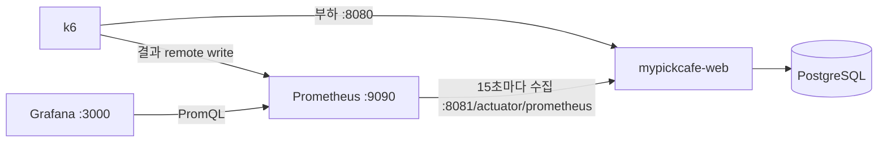

# MyPickCafe 모니터링·부하 테스트

Spring Boot 앱의 지표를 **Prometheus** 가 모으고 **Grafana** 로 보며, **k6** 로 부하를 줘서 어디까지 버티는지 숫자로 확인한다.
모두 배포에 쓰는 `docker-compose.yml` 안에 프로필로 들어 있어, 부하 테스트는 운영과 같은 이미지·메모리 한도·prod 프로파일의 컨테이너를 대상으로 한다.

| 프로필 | 서비스 | 기본 `docker compose up` | 배포(`deploy.sh`) |
| --- | --- | --- | --- |
| `monitoring` | prometheus, grafana | 뜨지 않음 | 건드리지 않음 |
| `k6` | k6 (테스트할 때만 `run --rm`) | 뜨지 않음 | 건드리지 않음 |

## 구성



| 파일 | 역할 |
| --- | --- |
| `MyPickCafe_Springboot/build.gradle` | `spring-boot-starter-actuator`, `micrometer-registry-prometheus` |
| `MyPickCafe_Springboot/.../application.properties` | 관리 포트 8081, `health`·`prometheus` 만 노출, 응답 시간 histogram, Tomcat 스레드 지표 |
| `MyPickCafe_Springboot/.../SecurityConfig.java` | `/actuator/health`, `/actuator/prometheus` 만 인증 없이 허용 |
| `.../security/ActuatorExposureTest.java` | 관리 포트에서만 열리는지, 다른 엔드포인트는 막혔는지, 대시보드가 쓰는 지표가 나오는지 |
| `docker-compose.yml` | `prometheus`·`grafana`(monitoring), `k6`(k6), `monitoring` 네트워크 |
| `monitoring/prometheus/prometheus.yml` | 수집 대상(`mypickcafe-web:8081`) |
| `monitoring/prometheus/alert-rules.yml` | 알림 규칙 5개 |
| `monitoring/grafana/provisioning/` | 데이터 소스·대시보드 자동 등록 |
| `monitoring/grafana/dashboards/` | `MyPickCafe 웹 서버`, `k6 부하 테스트` 대시보드 |
| `monitoring/k6/` | `smoke.js`, `load.js`, `stress.js`, 공통 흐름 `lib/mypickcafe.js` |

### 지표를 밖에 내보내지 않는 방법

- Actuator 는 **관리 포트 8081** 에서만 열린다. Caddy 는 8080 만 프록시하고, compose 는 8081 을 호스트에 열지 않는다.
  `monitoring` 네트워크에 붙은 Prometheus 만 가져갈 수 있다. 메인 포트의 `/actuator/prometheus` 는 404 다.
- 노출하는 엔드포인트는 `health`(상태만, 상세 없음)와 `prometheus` 둘뿐이다. `env`·`beans`·`heapdump` 등은 열지 않는다.
- Grafana(3000)·Prometheus(9090)는 `127.0.0.1` 에만 연다. Prometheus 는 인증이 없고 remote write 로 데이터를 넣을 수 있기 때문이다.
- 모니터링 컨테이너는 `monitoring` 네트워크에만 붙어 postgres·AI 서버에 닿지 않는다.

## 처음 한 번: 준비

### 1. `.env`

`.env` 는 git 에 없다. 루트에서 `.env.example` 을 복사해 채운다. 다른 PC 에서 쓰던 `.env` 가 있으면 그대로 가져오는 게 편하다.

```powershell
Copy-Item .env.example .env
```

부하 테스트에 필요한 값은 `POSTGRES_*`, `JWT_SECRET`, `SPRING_PROFILES_ACTIVE=prod` 다.
`LLM_API_KEY` 는 픽봇·리뷰 분석에만 쓰고 부하 테스트에는 필요 없다. 로그인 시나리오까지 돌리려면 `K6_USER_EMAIL`·`K6_USER_PASSWORD` 를 채운다.

### 2. 데이터 준비

**데이터가 없으면 부하 테스트 숫자가 의미가 없다.** 카페 목록(좋아요순)은 리뷰 전체를 집계하고, 카페 상세는 리뷰를 모두 읽는다. 리뷰가 0건이면 실제보다 훨씬 가볍게 나온다.
리뷰 더미(`review_dummy.sql`)와 원본 크롤링 CSV 는 git 에 없으므로, **데이터가 있는 PC 에서 DB 를 덤프해 옮기는 방법을 권한다.**

**A. 다른 PC 의 DB 를 옮기기 (권장)**

PowerShell 의 `>` 는 바이너리를 깨뜨리므로 컨테이너 안에 파일로 만든 뒤 `docker cp` 로 꺼낸다.

```powershell
# 데이터가 있는 PC (저장소 루트)
docker compose exec postgres pg_dump -U mypickcafe -d mypickcafe -Fc -f /tmp/mypickcafe.dump
docker cp mypickcafe-postgres:/tmp/mypickcafe.dump .\mypickcafe.dump

# 옮겨 갈 PC (저장소 루트, .env 준비 후)
docker compose up -d postgres
docker cp .\mypickcafe.dump mypickcafe-postgres:/tmp/mypickcafe.dump
docker compose exec postgres pg_restore -U mypickcafe -d mypickcafe --no-owner /tmp/mypickcafe.dump
```

`-U`·`-d` 는 각 PC `.env` 의 `POSTGRES_USER`·`POSTGRES_DB` 값이다. 이미 테이블이 있는 DB 에 덮어쓸 때는 `pg_restore` 에 `--clean --if-exists` 를 붙인다.
덤프 파일은 git 에 올리지 않는다(회원 이메일·비밀번호 해시가 들어 있다).

**B. 저장소에 있는 더미만 넣기 (리뷰 없음)**

점주 225명·카페 225곳·리뷰어 100명만 있다. 화면 흐름과 모니터링 연결을 확인하는 데는 충분하지만, 성능 숫자는 낙관적으로 나온다.

```powershell
docker compose up -d postgres
# 테이블 만들기: dev 프로파일(ddl-auto=update)로 한 번 띄운다
$env:SPRING_PROFILES_ACTIVE = 'dev'; docker compose up -d --build --no-deps mypickcafe-web; Remove-Item Env:SPRING_PROFILES_ACTIVE
docker compose logs -f mypickcafe-web   # "Started MyPickCafeApplication" 이 보이면 Ctrl+C
# PowerShell 5.1 의 파이프는 한글을 ? 로 바꾸므로 파일을 컨테이너에 복사해 psql -f 로 넣는다(순서: 점주 → 카페 → 리뷰어)
foreach ($f in 'cafeowner_dummy.sql', 'cafe_dummy.sql', 'reviewer_dummy.sql') {
  docker cp "MyPickCafe_AI\Create_Dummy\$f" "mypickcafe-postgres:/tmp/$f"
  docker compose exec postgres psql -q -U mypickcafe -d mypickcafe -v ON_ERROR_STOP=1 -f "/tmp/$f"
}
# 테이블을 만든 뒤에는 prod 로 다시 띄운다(아래 "실행"의 1번)
```

더미 회원의 비밀번호는 저장소에 없다. 로그인 시나리오용 계정은 사이트의 회원가입으로 하나 만든다(비밀번호 8~20자).

## 실행

저장소 루트에서 실행한다.

### 1. 앱 띄우기

```powershell
docker compose up -d postgres
docker compose up -d --build --no-deps mypickcafe-web
```

AI 서버(`mypickcafe-ai`)는 빼고 띄운다. 부하 테스트 화면은 AI 를 부르지 않고, AI 가 처음 뜰 때 리뷰 전체를 임베딩(CPU 로 수십 분)하면서 CPU 를 차지해 숫자가 흔들린다.
전체 스택을 띄웠다면 `docker compose logs -f mypickcafe-ai` 에서 인덱싱이 끝난 뒤에 테스트한다.

### 2. 모니터링 켜기

```powershell
docker compose --profile monitoring up -d prometheus grafana
```

| 주소 | 확인할 것 |
| --- | --- |
| http://localhost:9090/targets | `mypickcafe-web` 이 **UP** |
| http://localhost:9090/alerts | 규칙 5개(AppDown, HighErrorRate, SlowResponses, DbConnectionWait, HeapNearLimit) |
| http://localhost:3000 | `admin` / `.env` 의 `GRAFANA_ADMIN_PASSWORD`(비우면 `admin`). Dashboards → MyPickCafe |

`--profile monitoring up -d` 뒤에 서비스 이름을 빼면 AI·Ollama 까지 모두 뜬다.

### 3. 테스트 — 항상 스모크 → 부하 → 스트레스 순서

```powershell
docker compose run --rm k6 run /scripts/smoke.js
docker compose run --rm k6 run -o experimental-prometheus-rw /scripts/load.js
docker compose run --rm k6 run -o experimental-prometheus-rw /scripts/stress.js
echo $LASTEXITCODE   # 0 = 기준 통과, 99 = 기준(threshold) 위반
```

- `-o experimental-prometheus-rw` 를 붙여야 결과가 Prometheus 로 가서 **k6 부하 테스트** 대시보드에 그려진다.
  응답 시간은 native histogram(`k6_http_req_duration_seconds`)으로 보낸다(compose 의 `K6_FEATURES`).
  원본 가이드의 `k6_http_req_duration_p95` 는 화면(name 태그)별로만 나와 전체 p95 로 합칠 수 없어서 바꿨다.
- 진행 막대가 길게 찍히면 `run --quiet` 를 붙인다.
- 사람 수만 바꿔 보려면 `docker compose run --rm -e PEAK_VUS=100 k6 run ... /scripts/load.js`.

## 부하 수치를 이렇게 잡은 이유

| 테스트 | 사용자(VU) | 화면 사이 대기 | 시간 | 기준 (어기면 종료 코드 99) |
| --- | --- | --- | --- | --- |
| smoke | 1 | 1초 | 20초 | 모든 응답 200 (화면 12종을 한 번씩) |
| load | 50 = 비로그인 40 + 로그인 10 | 1~3초 | 4분 30초 | 실패 1% 미만, p95 500ms·p99 1.5초 미만, 로그인 p95 1초 미만 |
| stress | 20 → 100 → 200 → 300, 단계마다 1분 유지 | 없음 | 7분 | p95 1초·실패 1% (어기는 단계가 한계) |

- **load 50명**: 개인이 운영하는 지역 카페 탐색 서비스(EC2 t3.large 한 대)의 피크를 넉넉히 잡은 가정이다. 화면을 1~3초씩 읽으며 둘러보는 50명은 초당 약 30건의 요청이다(로그인 사용자의 머리글 API 호출 포함). 가정이 다르면 `PEAK_VUS` 로 바꾼다.
- **기준**: 원본 가이드의 데모 API 는 일부러 10% 실패했지만 이 앱은 실패하면 안 되므로 실패율 기준을 1% 로 잡았다. 기준은 테스트 전에 정한 값이며, 결과를 보고 고치지 않는다.
- **stress 계단**: 이 앱의 대기열 두 개에 맞췄다. **20명** = prod 의 DB 커넥션 풀 크기(`DB_POOL_MAX=20`), **200명** = Tomcat 기본 스레드 수. 대기 없이 요청하므로 VU 수보다 훨씬 큰 부하다.
- **로그인 사용자 20%**: 로그인(BCrypt), 니즈 기반 추천 목록, 머리글 스크립트의 `/api/auth/me`·알림 개수 호출이 비로그인과 다른 부하를 만든다. VU 마다 처음 한 번만 로그인한다.
- **넣지 않은 것**: 리뷰 작성·찜·카페 등록 같은 쓰기 요청(데이터가 쌓이고 리뷰 작성은 AI 를 부름), 픽봇(요청마다 외부 LLM 비용이 들고 앱이 아니라 LLM 응답 시간을 재게 됨).

### 결과 읽기

**k6 부하 테스트** 대시보드에서 볼 것:

| 그래프 | 읽는 법 |
| --- | --- |
| 초당 요청 수 | VU 를 늘려도 더 오르지 않는 지점이 처리량 한계 |
| 응답 시간 p95: k6 vs 앱 | 둘 다 최근 30초의 p95. 둘이 벌어지면 "처리는 빠른데 줄이 길다". 앱 지표는 스레드를 잡은 뒤부터 재고, k6 는 사용자 쪽에서 잰다 |
| 화면별 응답 시간 p95 | 어느 화면이 먼저 느려지는지(보통 `cafe-list(likes)`, `cafe-detail`) |
| 줄이 생기는 곳 | DB 커넥션 대기가 먼저 오르는지, Tomcat 스레드가 먼저 차는지 |

**MyPickCafe 웹 서버** 대시보드는 평소 상태(요청·에러·응답 시간·DB 커넥션·스레드·힙·CPU·GC·AI 호출)를 본다.

### 검증 기록 (2026-11-11, 참고용)

설정이 동작하는지 확인하려고 노트북(16스레드·16GB)에서 저장소의 더미 데이터(**카페 225곳, 리뷰 0건**)로 돌린 결과다.
리뷰가 없어 실제보다 훨씬 가볍게 나온다. 성능 판단에 쓰지 말고, 대시보드를 읽는 예로만 본다.

- smoke: 화면 12종 모두 200. load: 7,438건, 실패 0, p95 21ms, 로그인 p95 71ms, 정점 초당 약 33건.
- stress: 36.8만 건, 실패 0, 전체 p95 551ms. 단계별(각 단계 유지 구간):

| VU | k6 초당 요청 | k6 p95 | 앱 p95 | DB 커넥션 사용/대기 | Tomcat 바쁜 스레드 |
| --- | --- | --- | --- | --- | --- |
| 20 | 1,201 | 31ms | 28ms | 17 / 0 | 19 |
| 100 | 963 | 268ms | 256ms | 19 / 66 | 91 |
| 200 | 925 | 604ms | 612ms | 20 / 177 | 198 |
| 300 | 934 | 785ms | 655ms | 20 / 179 | 200 |

읽는 법: 처리량은 20명에서 이미 최대이고 그 뒤로는 늘지 않는다. 100명부터 DB 커넥션 20개가 모두 쓰이고 대기가 쌓이므로, 이 조건의 첫 병목은 **DB 커넥션 풀**이다.
300명에서는 Tomcat 스레드 200개도 다 차서, k6 p95(785ms)와 앱 p95(655ms)의 차이만큼 스레드 앞에서 줄을 섰다.
JVM CPU 는 44% 정도로 여유가 있었다. 단, EC2(vCPU 2개)에서는 CPU 가 먼저 막힐 수 있으므로 실제 데이터와 아래 CPU 제한으로 다시 재야 한다.

## 주의

- **같은 PC 에서 k6 와 앱을 같이 돌리면 k6 도 CPU 를 쓴다.** 절대값보다 추세(어느 단계에서 꺾이는지)를 본다.
- **노트북은 EC2 보다 훨씬 빠르다.** t3.large 는 vCPU 2개를 web·postgres·AI·Ollama 가 나눠 쓴다. 비슷하게 보려면 테스트 전에 CPU 를 묶는다.
  `docker update --cpus 1.5 mypickcafe-web; docker update --cpus 0.5 mypickcafe-postgres`
  원래대로: `docker compose up -d --no-deps --force-recreate mypickcafe-web postgres`
- **운영 서버에 stress 를 돌리지 않는다.** 실제 사용자에게 영향을 준다.
- dev 프로파일은 SQL 을 DEBUG 로그로 찍어 느리다. 부하 테스트는 컨테이너의 prod 프로파일로 한다.
- 원본 가이드 실습 프로젝트의 Prometheus·Grafana 가 9090·3000 을 쓰고 있으면 겹친다. 그쪽을 끄거나 `.env` 의 `PROMETHEUS_PORT`·`GRAFANA_PORT` 를 바꾼다.

## 다른 경우

### IDE 로 띄운 앱을 볼 때

IDE 의 앱도 관리 포트 8081 을 연다(`MyPickCafe_Springboot/secret.properties` 가 있어야 기동한다).
`monitoring/prometheus/prometheus.yml` 에서 `mypickcafe-web:8081` job 을 주석 처리하고 `host.docker.internal:8081` job 의 주석을 푼 뒤 `docker compose restart prometheus`.
k6 는 `.env` 에 `K6_BASE_URL=http://host.docker.internal:8080` 을 넣는다.

### EC2 에서 모니터링 켜기 (선택)

이 변경이 배포된 뒤(web 이 `monitoring` 네트워크에 붙은 뒤)에 서버 저장소 경로(`EC2_APP_DIR`)에서 실행한다. 배포된 이미지를 쓰도록 override 를 함께 넘긴다.

```bash
sudo docker compose -f docker-compose.yml -f /var/lib/mypickcafe-deploy/images.override.yml \
  --profile monitoring up -d prometheus grafana
```

- 메모리: 상시 6.5GB 에 Prometheus·Grafana 한도 각 512MB 가 더해져 t3.large(8GB)에 여유가 적다(실사용은 Prometheus 약 55MB, Grafana 약 180~220MB). `.env` 에 `PROMETHEUS_RETENTION=7d` 를 권한다.
- `.env` 의 `GRAFANA_ADMIN_PASSWORD` 를 반드시 채운다(처음 뜰 때만 적용).
- 접속은 포트를 열지 않고 SSM 포트 포워딩으로 한다(내 PC 에 Session Manager 플러그인과 `ssm:StartSession` 권한 필요).
  `aws ssm start-session --target <인스턴스ID> --document-name AWS-StartPortForwardingSession --parameters "portNumber=3000,localPortNumber=3000"`
- `deploy.sh` 는 web·ai 만 교체하므로 Prometheus·Grafana 는 배포와 상관없이 계속 돈다.

## 끄기와 정리

```powershell
docker compose --profile monitoring stop prometheus grafana   # 끄기 (데이터 유지)
docker compose --profile monitoring rm -f prometheus grafana  # 컨테이너 삭제 (데이터 유지)
docker volume rm mypickcafe_prometheus-data mypickcafe_grafana-data   # 수집한 지표·Grafana 설정까지 삭제
```

`docker compose down -v` 는 쓰지 않는다. DB(`pgdata`)·업로드 파일·Chroma 인덱스 볼륨까지 지워진다.

## 문제가 생기면

| 증상 | 원인 | 해결 |
| --- | --- | --- |
| Targets 에서 `mypickcafe-web` 이 DOWN, `no such host` | web 컨테이너가 꺼져 있거나 이 변경 전 설정으로 떠서 `monitoring` 네트워크에 없음 | `docker compose up -d --no-deps mypickcafe-web` |
| k6 setup 에서 `승인된 카페가 0개` | DB 가 비어 있음 | 위 "데이터 준비" |
| k6 setup 에서 로그인 실패 | `.env` 의 `K6_USER_*` 가 틀림 | 그대로 VU 마다 로그인하면 로그인 제한(5회 실패 → 5분 차단)에 걸리므로 테스트를 시작하지 않는다. 계정을 확인한다 |
| 대시보드를 고쳤는데 그대로 | Grafana 는 시작할 때만 읽음 | `docker compose restart grafana` |
| k6 대시보드가 비어 있음 | `-o experimental-prometheus-rw` 를 빼고 실행함 | 붙여서 다시 실행 |
| 테스트에서 `/actuator/prometheus` 가 404 | Spring Boot 테스트는 기본으로 지표 내보내기를 끔 | 테스트 클래스에 `@AutoConfigureObservability` |
| `docker` 가 `cannot find the file specified` | Docker Desktop 이 꺼져 있음 | 켜고 1분쯤 기다린다 |
